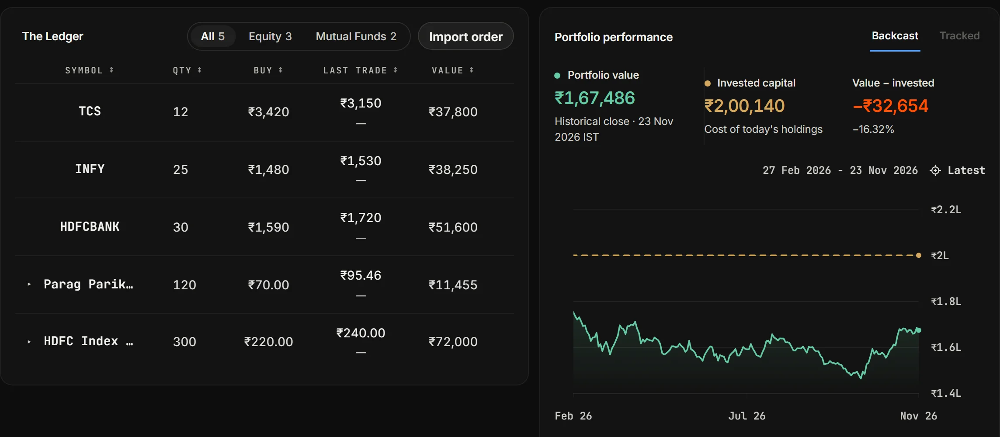
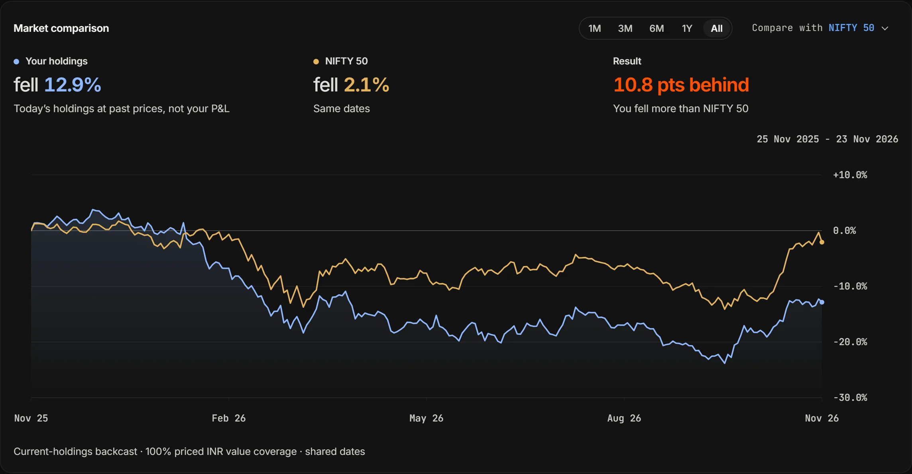

<div align="center">
  

  <h1>Finverse</h1>

  <p><strong>Know what you own. See what moves.</strong></p>
  <p>A private portfolio workspace for Indian investors. Import your stocks, ETFs and mutual funds, then follow prices, NAVs, news and the market around them. No account; your holdings stay in your browser.</p>

  <p>
    <a href="#features">Features</a> ·
    <a href="#get-started">Get started</a> ·
    <a href="#your-data">Your data</a> ·
    <a href="#development">Development</a>
  </p>
</div>



<p align="center"><sub>Overview with the sample workspace.</sub></p>

## Features

| Screen | What it answers |
| --- | --- |
| **Overview** | Today's session move, NIFTY 50 and Bank Nifty, the holdings ledger (25 per page, equity and fund scopes), portfolio performance and risk checks: drop from peak, time below peak, yearly swings and down sessions. |
| **Insights** | Value, invested and unrealised P&L; your holdings against NIFTY 50 or another Indian or global index; allocation treemap, sector and market-cap exposure, allocation mix and latest price movers. |
| **Monitor** | Market news, then IPOs (open, upcoming and recent, with GMP trends), an economic calendar (RBI, MoSPI, FOMC and high-impact global releases) and company updates. Watch rules alert you in the Overview bell. |
| **Research** | Links and history for a selected holding. |
| **Highlights** | Portfolio, weekly and monthly recaps as short stories, sized for a phone. |
| **Settings** | Imports and their review, instrument listings, mutual-fund schemes, recurring SIPs, appearance (Dark, Default, Light), Overview indices, backup and restore. |



<p align="center"><sub>Market comparison: today's holdings at past prices, against NIFTY 50.</sub></p>

**Imports.** Use the holdings export from Zerodha, Groww, INDmoney, Angel One or any `.xlsx`, `.xls` or `.csv` file. Add an account or update an existing one; every update shows the position changes and new totals before saving, and the previous statement is kept for undo.

**Prices.** Stock and index quotes refresh during NSE sessions from a public snapshot feed (not broker streaming). Mutual-fund NAVs are checked at MFAPI's published daily slots. Listings are matched to NSE by ISIN; nothing is guessed.

**SIPs.** Track recurring SIPs per confirmed scheme. Finverse estimates each instalment's NAV date from the NSE MF calendar; you choose which recorded instalments to add to a holding until your next statement confirms them.

**Privacy.** The eye button masks amounts, holding names and personal signals on every screen.

## Get started

You need Node.js 20+ and npm.

```bash
npm ci
npm run dev
```

Open the printed URL. The first visit to `/` shows the landing page once; after that `/` opens the app at `/app`. `/welcome` always shows the landing page. In the app, choose **Import portfolio** and pick your holdings file.

To try it without your own data, open `/app?sample` in development (or on a Vercel preview). It loads a sample workspace and never overwrites a real one.

## Your data

- Holdings, history, preferences and Monitor data are stored only in this browser. There is no account or portfolio server.
- Market data is on by default. Quote, history and news providers receive instrument identifiers, never quantities or costs.
- Backcasts apply **today's holdings** to past prices; they are not your trade history or P&L. Tracked history builds from daily snapshots on this device.
- Values are in INR with Indian digit grouping. Amounts in other currencies stay in import and backup metadata and are excluded from INR totals.
- Clearing browser data removes the workspace. Use **Download backup** in Settings and **Restore backup** in another browser. Backups are unencrypted financial records; keep them private.

## Development

| Command | Does |
| --- | --- |
| `npm run dev` | Vite dev server with the local market-data API (`api/*`) mounted |
| `npm run dev:monitor` | Dev server opened on Monitor |
| `npm test` | Vitest suite |
| `npm run build` | Type-check and production build |

- `src/` React 19 + TypeScript app. Screens live in `src/views`, the landing page in `src/landing`.
- `api/` serverless handlers for quotes, history, news, IPOs, NSE listings, market cap and the economic calendar. They run on Vercel (`bom1`) and inside the Vite dev server.
- `vercel.json` and `public/_headers` carry the routing and security headers, including a strict CSP. Edit the inline theme script in `index.html` only together with its CSP hash.

Market data is indicative and may be delayed. Finverse is not investment advice.
